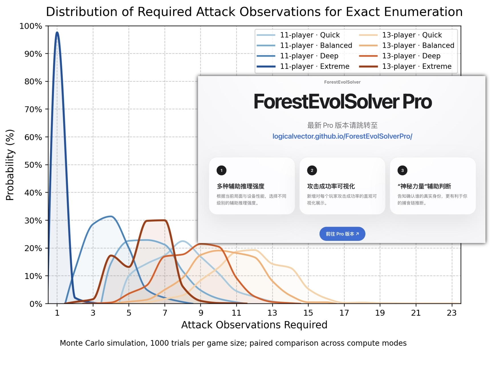
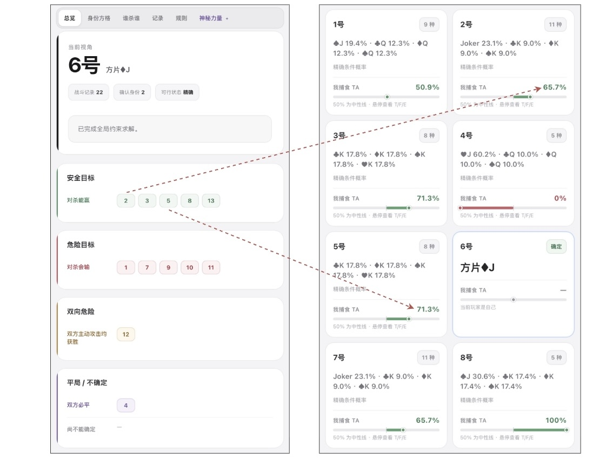
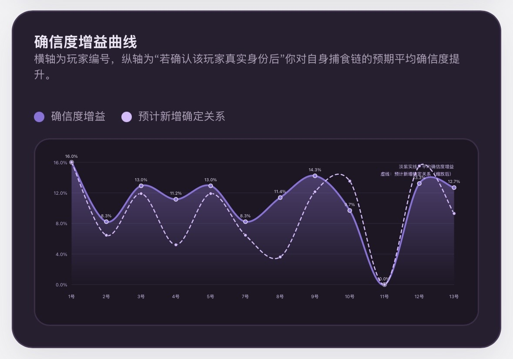

# ForestEvolSolverPro

《森林进化论》辅助推理工具，支持 11 人局和 13 人局。

在线使用：[ForestEvolSolverPro](https://logicalvector.github.io/ForestEvolSolverPro/)

## 功能更新

### 1. 运算强度对比

新增模拟结果对比，展示 11 人局和 13 人局在不同运算强度下，完成精确枚举所需的攻击观察次数分布。每种人数设定进行了 1000 次蒙特卡洛模拟。

  

### 2. 攻防关系和成功率

新增攻防关系分类和攻击成功率展示，可查看已确定的攻防结果，以及其他玩家的捕食成功概率。

  

### 3. 神秘力量

新增“神秘力量”功能，根据当前已知信息，推荐优先确认真实身份的玩家，并给出预计的置信度提升。

  

### 4. 置信度增益曲线

新增置信度增益曲线，比较确认不同玩家真实身份后，预计带来的置信度提升和新增确定关系数量。

  

### 5. 界面主题切换

新增银白、灰黑两种界面主题，可按需要切换。

  

